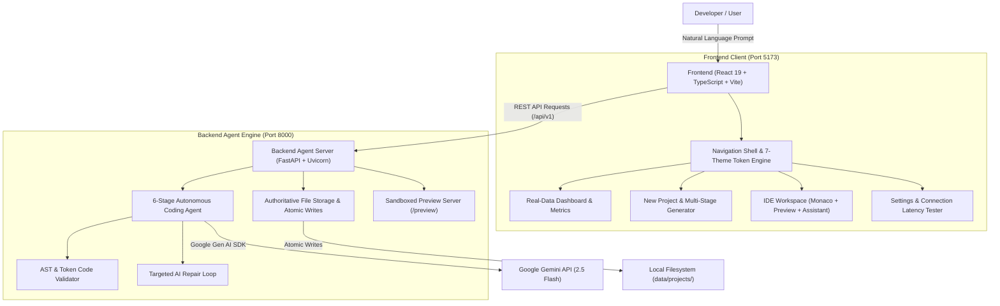

# ⚡ AutoDevAI — Autonomous Coding Agent Using Generative AI

<div align="center">

[](https://fastapi.tiangolo.com/)
[](https://react.dev/)
[](https://www.typescriptlang.org/)
[](https://www.python.org/)
[](https://ai.google.dev/)
[-success?style=flat-square)](./scripts/run-tests.ps1)
[](LICENSE)

**An autonomous AI development agent, project dashboard, and IDE workspace that converts natural-language software requirements into validated, production-ready, multi-file web applications.**

[Key Features](#-key-features) • [Architecture](#-architecture) • [Getting Started](#-getting-started) • [IDE Workspace](#-ide-workspace) • [Testing](#-testing--quality-assurance) • [Security](#-security--sandboxing) • [API Docs](#-backend-api-reference)

</div>

---

## 📖 Overview

**AutoDevAI** is an end-to-end autonomous coding agent built on the architecture specified in the BlackBucks Internship Report (*"An Autonomous Coding Agent Using Generative AI"*).

Unlike static boilerplate generators or superficial chat interfaces, AutoDevAI acts as an end-to-end software architect and engineer:
1. Analyzes conversational English requirements into structured architectural specifications.
2. Synthesizes coherent, multi-file web applications (HTML5, modular CSS, vanilla ES6+ JavaScript).
3. Automatically audits generated code for syntax errors, balanced braces, and broken local file references.
4. Executes an autonomous AI repair loop if defects are caught.
5. Serves a sandboxed live preview with desktop, tablet, and mobile viewport emulation.
6. Provides an interactive IDE workspace with a Monaco editor, contextual AI assistance, and single-click ZIP archive export.

---

## ⚡ Key Features

- **🗣️ Natural-Language Requirement Processing**: Turn plain conversational descriptions into complete applications without writing boilerplate. Includes quick starter templates (*Kanban Board, Expense Tracker, Markdown Hub, Analytics Dashboard*).
- **📁 Autonomous Multi-File Generation**: Produces complete, non-stubbed source code files (`index.html`, `css/styles.css`, `js/app.js`, `README.md`) with explicit separation of concerns and local persistence.
- **🛡️ Automated AST & Token Validation**: Automatically checks HTML5 structure, CSS brace balance and comment closures, JavaScript bracket/parentheses matching, and cross-file references (verifying that all `<link>` and `<script>` paths actually exist).
- **🔁 Bounded AI Repair Loop**: Automatically captures validation errors and prompts Gemini for targeted code patches with bounded retries before finalizing.
- **💻 Full IDE Workspace**:
  - **File Explorer**: Nested directory tree with inline file creation, renaming, and deletion.
  - **Monaco Code Editor**: Multi-tab code editor with syntax highlighting, `Ctrl+S` save shortcut, dirty tracking (`●`), word wrap toggle, and font scaling.
  - **Sandboxed Live Preview**: Embedded iframe with responsive sizing (Desktop 100%, Tablet 768px, Mobile 375px), instant refresh, and external window support.
  - **AI Assistant Companion**: Project-aware chat that understands active files and can propose and apply code patches with diff summaries.
  - **Validation Drawer**: Collapsible diagnostic reports categorizing Passed, Warning, and Failed checks.
- **📊 Real Data Dashboard**: Metrics (Total projects, ready projects, generated files, lines of code) and responsive SVG charts computed from real local disk data.
- **🎨 7 Mandatory Built-in Themes**:
  - `Clean Light`, `Modern Dark`, `Deep Midnight`, `OLED Black`, `Nord Arctic`, `Evergreen Forest`, and `Warm Sand`.
  - Application-wide design tokens styling all navigation, cards, modals, inputs, and the Monaco editor.
- **📦 Production ZIP Export**: Instant download of self-contained, sanitized project archives.
- **🔌 Dual-Engine Execution**: Operates with Google Gemini 2.5 Flash via the official `google-genai` Python SDK, and includes a built-in **Deterministic Test Provider** for 100% offline usage and testing without an API key.

---

## 🏗️ Architecture



---

## 📁 Repository Structure

```text
├── backend/
│   ├── app/
│   │   ├── api/             # REST endpoints (health, projects, files, generation, ai, etc.)
│   │   ├── models/          # Pydantic data schemas & request/response models
│   │   ├── services/
│   │   │   ├── storage.py   # Authoritative filesystem persistence & atomic writes
│   │   │   ├── validator.py # HTML, CSS, JS, reference & security validators
│   │   │   ├── gemini.py    # Google Gen AI SDK wrapper & deterministic test provider
│   │   │   ├── agent.py     # 6-stage autonomous agent execution pipeline
│   │   │   └── preview.py   # Sandboxed preview server with CSP headers
│   │   ├── config.py        # Centralized settings & limits
│   │   └── main.py          # FastAPI application entrypoint
│   ├── tests/               # 11 Unit & Integration Pytest suites
│   ├── requirements.txt     # Backend Python dependencies
│   └── .env.example         # Backend environment template
├── frontend/
│   ├── src/
│   │   ├── components/      # Common UI, Dashboard, Generator, Workspace, Settings
│   │   ├── context/         # ThemeContext (7 themes) & NotificationContext
│   │   ├── pages/           # Dashboard, NewProject, Projects, Workspace, Playground, Settings, Docs
│   │   ├── services/        # Centralized typed API client & interfaces
│   │   ├── styles/          # Tailwind setup & themes.css (CSS design tokens)
│   │   └── test/            # Vitest unit & component test suites
│   ├── package.json
│   ├── tailwind.config.js
│   └── vite.config.ts
├── data/
│   └── projects/            # Authoritative persistent storage for generated projects
├── scripts/
│   ├── run-dev.ps1          # Single-command startup for frontend & backend
│   ├── run-backend.ps1      # PowerShell backend launcher
│   ├── run-frontend.ps1     # PowerShell frontend launcher
│   └── run-tests.ps1        # Runs both backend & frontend test suites
├── .env.example
├── .gitignore
└── README.md
```

---

## 🚀 Getting Started

### Prerequisites
- **Node.js**: `v18+` (Recommended: `v20 LTS` or `v24`)
- **Python**: `v3.10+` (Tested on `v3.13`)
- **Git**

---

### Step 1: Clone the Repository
```bash
git clone https://github.com/your-username/autodev-ai.git
cd autodev-ai
```

---

### Step 2: Backend Setup
Create and activate a virtual environment, then install Python dependencies:

**Windows (PowerShell):**
```powershell
python -m venv backend\venv
.\backend\venv\Scripts\pip install -r backend\requirements.txt
```

**macOS / Linux:**
```bash
python3 -m venv backend/venv
source backend/venv/bin/activate
pip install -r backend/requirements.txt
```

---

### Step 3: Frontend Setup
Install npm packages:
```bash
cd frontend
npm install
cd ..
```

---

### Step 4: Environment Configuration
Create your environment file:
```bash
cp .env.example backend/.env
```

*(Optional)* Configure your Google Gemini API key:
```ini
GEMINI_API_KEY=your_gemini_api_key_here
GEMINI_MODEL=gemini-2.5-flash
```

> 💡 **Offline Mode**: If `GEMINI_API_KEY` is omitted or left empty, AutoDevAI automatically runs in **Deterministic Test Mode**. The complete multi-file generation, validation, preview, and export pipeline functions 100% offline without requiring an API key.

---

### Step 5: Start the Application

#### Option A: Single-Command Launch (Windows PowerShell)
```powershell
.\scripts\run-dev.ps1
```

#### Option B: Manual Launch (Two Terminals)

**Terminal 1 (Backend):**
```bash
# Windows
$env:PYTHONPATH="backend"; .\backend\venv\Scripts\python -m uvicorn app.main:app --port 8000 --reload

# macOS / Linux
export PYTHONPATH=backend
backend/venv/bin/python -m uvicorn app.main:app --port 8000 --reload
```

**Terminal 2 (Frontend):**
```bash
cd frontend
npm run dev
```

---

### 🌐 Accessing the Application

| Service | URL | Description |
| :--- | :--- | :--- |
| **Frontend IDE** | [http://localhost:5173](http://localhost:5173) | Main AutoDevAI Workspace & Dashboard |
| **Backend REST API** | [http://127.0.0.1:8000](http://127.0.0.1:8000) | FastAPI Agent Engine |
| **Interactive API Docs** | [http://127.0.0.1:8000/api/v1/docs](http://127.0.0.1:8000/api/v1/docs) | Swagger / OpenAPI Documentation |

---

## 🖥️ IDE Workspace Guide

AutoDevAI's Workspace (`/workspace/:projectId`) provides a full developer experience:

```text
+---------------------------------------------------------------------------------------+
|  AutoDevAI  /  Project Name  [Ready]                 [Live Preview] [AI Assistant]    |
+-------------------+------------------------------------+------------------------------+
| EXPLORER          | index.html  ● styles.css           | [Desktop] [Tablet] [Mobile]  |
|                   |------------------------------------|------------------------------+
| 📁 css/           | 1 <!DOCTYPE html>                  |                              |
|   └── styles.css  | 2 <html lang="en">                 |   [LIVE PREVIEW CANVAS]      |
| 📁 js/            | 3 <head>                           |   Real, sandboxed execution  |
|   └── app.js      | 4   <title>App</title>             |   with responsive sizing     |
| 📄 index.html     | 5 </head>                          |                              |
| 📝 README.md      | 6 <body>...</body>                 |                              |
+-------------------+------------------------------------+------------------------------+
| VALIDATION REPORT: 9 Checks Passed, 0 Warnings, 0 Failures             [Re-validate]  |
+---------------------------------------------------------------------------------------+
```

### Key Keyboard Shortcuts
- `Ctrl + S` / `Cmd + S`: Save active file and trigger background re-validation.
- `Escape`: Close open modals or dropdown dialogs.

---

## 🎨 7-Theme Design System

AutoDevAI includes 7 design palettes configured via CSS design tokens (`themes.css`). Every theme styles the entire UI, buttons, modals, cards, and the Monaco editor:

| Theme Name | Identifier | Primary Palette & Accents |
| :--- | :--- | :--- |
| **Clean Light** | `light` | Crisp slate surfaces (`#f8fafc`) with indigo accents (`#4f46e5`) |
| **Modern Dark** | `dark` | Deep slate navy (`#0b0f19`) with vibrant indigo (`#6366f1`) |
| **Deep Midnight** | `midnight` | Oceanic navy (`#050b14`) with sky/cyan highlights (`#0ea5e9`) |
| **OLED Black** | `oled-black` | Pure black (`#000000`) with high-contrast emerald borders (`#10b981`) |
| **Nord Arctic** | `nord` | Polar night slate (`#2e3440`) with frosted turquoise (`#88c0d0`) |
| **Evergreen Forest** | `forest` | Deep organic pine (`#07150e`) with soothing moss green (`#22c55e`) |
| **Warm Sand** | `warm-sand` | Desert stone palette (`#faf6f0`) with amber and terracotta (`#d97706`) |

*Switch themes at any time from the top navigation dropdown or Settings page. Your preference is persisted across reloads in `localStorage`.*

---

## 🧪 Testing & Quality Assurance

The repository includes a test suite with **20 automated tests** covering backend unit logic, security traversal rules, integration lifecycles, and frontend React components.

### Run All Tests (Single Command)
```powershell
.\scripts\run-tests.ps1
```

### Backend Tests (Pytest)
```bash
$env:PYTHONPATH="backend"; .\backend\venv\Scripts\pytest backend\tests -v
```
- `test_storage.py`: Project CRUD, file write/read, tree hierarchy, atomic persistence, and stats.
- `test_validator.py`: HTML5 structure validation, CSS brace checking, JS syntax balance, and local reference auditing.
- `test_agent.py`: 6-stage autonomous code synthesis pipeline and status tracker.
- `test_api_endpoints.py`: REST endpoints for projects, files, generation, health, and export.
- `test_security.py`: Canonical path normalization, directory traversal rejection (`../`, `\0`), and secret redaction.
- `test_integration.py`: End-to-end autonomous lifecycle test.

### Frontend Tests (Vitest)
```bash
cd frontend
npm test
```
- `themes.test.tsx`: Validates all 7 themes, CSS variable updates, and localStorage persistence.
- `navigation.test.tsx`: Verifies navigation shell, sidebar links, and navbar theme switcher.
- `components.test.tsx`: Tests Button states, Badge statuses, accessible Modal dialogs, genuine MetricsCards calculation, and RequirementForm submission.

---

## 🔒 Security & Sandboxing

AutoDevAI treats security as a core architectural principle:
1. **Directory Traversal Protection**: Every file access call is normalized via `resolve_safe_path(project_id, relative_path)`. Paths referencing parent directories (`../`), absolute paths, or null bytes (`\0`) are immediately rejected with HTTP 400.
2. **Iframe Preview Sandboxing**: Generated applications are served from `/preview/{project_id}/` with strict `Content-Security-Policy` headers (`default-src 'self' 'unsafe-inline' https: data:; frame-ancestors *; X-Content-Type-Options: nosniff`). Untrusted code cannot read backend API credentials or access parent origins.
3. **Atomic Writes**: Project metadata and files are written to `.tmp` files first and swapped atomically via `os.replace` to prevent corruption during unexpected shutdowns.
4. **No Arbitrary Command Execution**: The backend exposes no shell execution endpoints. AI code synthesis is strictly restricted to filesystem output.
5. **Secret Redaction**: API keys and environment variables are filtered from error traces, logs, and export ZIP archives.

---

## 📡 Backend API Reference

All REST endpoints are versioned under `/api/v1`:

| Method | Endpoint | Description |
| :--- | :--- | :--- |
| `GET` | `/api/v1/health` | Service health and Gemini configuration status |
| `GET` | `/api/v1/settings` | System settings, disk storage usage, and project counts |
| `POST` | `/api/v1/settings/test-connection` | Live Gemini connection ping and latency measurement |
| `GET` | `/api/v1/dashboard/metrics` | Computed metrics and recent activity log |
| `GET` | `/api/v1/projects` | List projects with search, filter, and sort query parameters |
| `POST` | `/api/v1/projects` | Create a new project directory and metadata |
| `GET` | `/api/v1/projects/{id}` | Retrieve project metadata |
| `PUT` | `/api/v1/projects/{id}` | Update project metadata |
| `DELETE` | `/api/v1/projects/{id}` | Permanently delete project directory and metadata |
| `POST` | `/api/v1/projects/{id}/duplicate` | Duplicate an existing project and its files |
| `GET` | `/api/v1/projects/{id}/files` | Retrieve hierarchical project file tree |
| `GET` | `/api/v1/projects/{id}/files/content` | Read content of a specific file |
| `POST` | `/api/v1/projects/{id}/files` | Create a new file |
| `PUT` | `/api/v1/projects/{id}/files` | Update file content atomically |
| `DELETE` | `/api/v1/projects/{id}/files` | Delete a file or folder |
| `POST` | `/api/v1/projects/{id}/files/rename` | Rename or move a file |
| `POST` | `/api/v1/projects/{id}/generation/start` | Start 6-stage autonomous code synthesis |
| `GET` | `/api/v1/projects/{id}/generation/status` | Poll active generation progress and logs |
| `POST` | `/api/v1/projects/{id}/generation/retry` | Retry failed generation |
| `POST` | `/api/v1/projects/{id}/validation` | Run AST & token validation checks on project files |
| `POST` | `/api/v1/ai/chat` | Context-aware AI assistant chat |
| `POST` | `/api/v1/ai/explain` | AI code explanation for a selected file |
| `POST` | `/api/v1/ai/apply-patch` | Apply proposed AI patches directly to project files |
| `GET` | `/api/v1/projects/{id}/export` | Stream project source code as a ZIP archive |
| `GET` | `/preview/{id}/` | Serve sandboxed preview files with security headers |

---

## ❓ FAQ & Troubleshooting

<details>
<summary><strong>1. Windows: "File cannot be loaded because running scripts is disabled"</strong></summary>

PowerShell restricts external scripts by default. Enable script execution for your user account:
```powershell
Set-ExecutionPolicy -Scope CurrentUser RemoteSigned
```
</details>

<details>
<summary><strong>2. Ports 8000 or 5173 are already in use</strong></summary>

Check active ports and stop conflicting processes:
```powershell
Get-NetTCPConnection -LocalPort 8000, 5173 -ErrorAction SilentlyContinue
```
Or launch on alternative ports:
- Backend: `uvicorn app.main:app --port 8001`
- Frontend: `npm run dev -- --port 5174`
</details>

<details>
<summary><strong>3. How do I switch from offline mode to live Gemini AI?</strong></summary>

1. Get a free API key at [Google AI Studio](https://aistudio.google.com/app/apikey).
2. Open `backend/.env` and set:
   ```ini
   GEMINI_API_KEY=your_actual_key_here
   GEMINI_MODEL=gemini-2.5-flash
   ```
3. Restart the backend or test the connection on the **Settings** page (*Test Gemini Connection*).
</details>

---

## 📜 License

This project is licensed under the **MIT License** — see the [LICENSE](LICENSE) file for details.

Developed as an autonomous coding agent implementation based on the BlackBucks Internship Specification: *"An Autonomous Coding Agent Using Generative AI"*.
